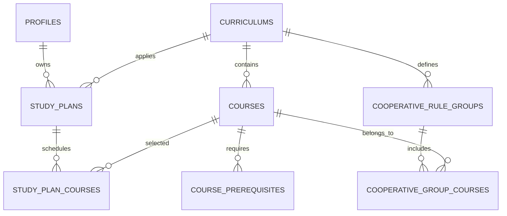

# PlanC — Software Requirements Specification

## 1. Purpose

PlanC helps KU Computer Engineering and Informatics students import their academic record, simulate study plans, verify curriculum completion, and check co-operative education eligibility.

## 2. Actors

| Actor | Responsibilities |
|---|---|
| Student | Sign in, view grades, create and manage study plans, review graduation and co-op eligibility. |
| Curriculum administrator | Import curriculum data, define course prerequisites and co-op rules. |

## 3. Functional requirements

| ID | Requirement |
|---|---|
| FR-01 | The student can sign in with KU credentials and retrieve profile and grade data. |
| FR-02 | The student can create, select, rename, duplicate and delete a study plan. |
| FR-03 | The student can add, move and remove courses from a plan by drag-and-drop or term selection. |
| FR-04 | The system validates term range, duplicate courses, prerequisite order and credit overload. |
| FR-05 | Moving a course cascades changes to direct and indirect dependent courses. |
| FR-06 | The system shows planned credits, remaining credits, missing required courses and overloaded terms. |
| FR-07 | The system evaluates co-op eligibility from the two prescribed course groups and each group GPA. |
| FR-08 | The student can print or export a study plan as PDF through the browser print dialog. |
| FR-09 | The administrator can import and maintain curriculum courses, categories and prerequisite rules. |

## 4. Non-functional requirements

| ID | Requirement |
|---|---|
| NFR-01 | The UI must support desktop and mobile screens from 320px wide. |
| NFR-02 | All user input must be validated on the client and server. |
| NFR-03 | A student can only access their own plans after Supabase authentication is connected. |
| NFR-04 | Course movement feedback should appear immediately without a full-page reload. |
| NFR-05 | The system must provide readable status colours and keyboard-accessible controls. |

## 5. Main use cases

1. **Manage study plan:** Student selects an existing plan, creates a new plan, or duplicates a scenario.
2. **Schedule a course:** Student drags a course to a term. The system validates prerequisites and cascades dependent courses.
3. **Review graduation:** Student reviews remaining credits, unplanned courses, and credit overload.
4. **Check co-op eligibility:** Student reviews completed credits and group GPAs before the year 4 co-op placement.
5. **Export plan:** Student prints the active plan or saves it as PDF.

## 6. Database design

See `docs/supabase-schema.sql`. Core relations:

```text
auth.users ── 1:1 ── profiles
profiles ── 1:N ── study_plans ── 1:N ── study_plan_courses ── N:1 ── courses
curriculums ── 1:N ── courses
courses ── N:N ── course_prerequisites
curriculums ── 1:N ── cooperative_rule_groups ── N:N ── courses
study_plans ── 1:N ── study_plan_history
```



## 7. Supabase integration boundary

The current `src/Planner/planRepository.js` is the local implementation. Replace `loadStudyPlans` and `saveStudyPlans` with Supabase queries after credentials and authentication are ready; the planner UI should not need to change.
